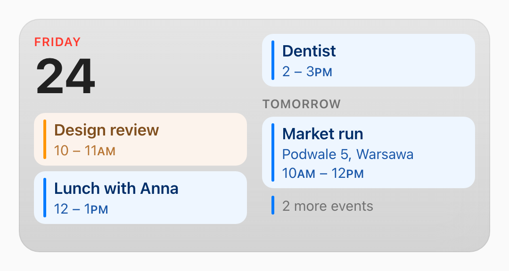
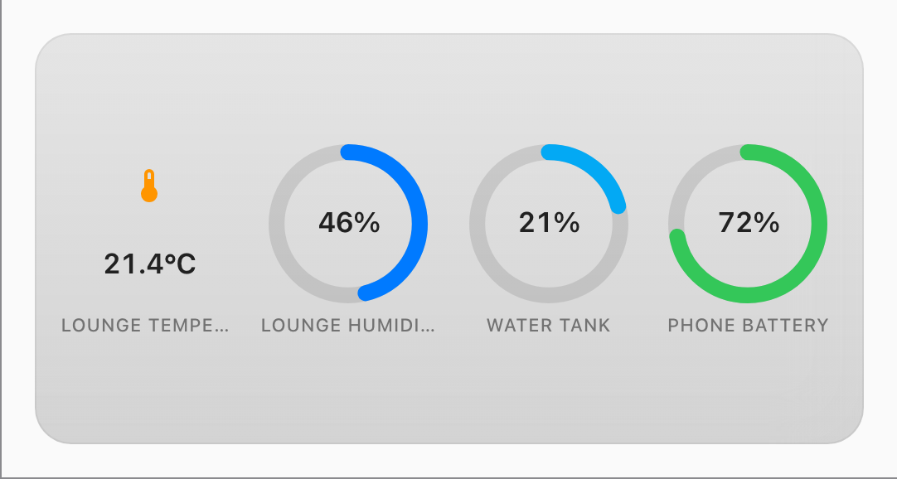
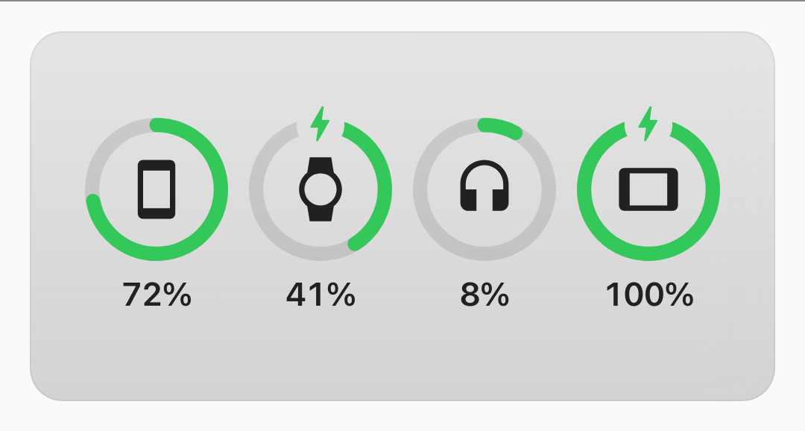
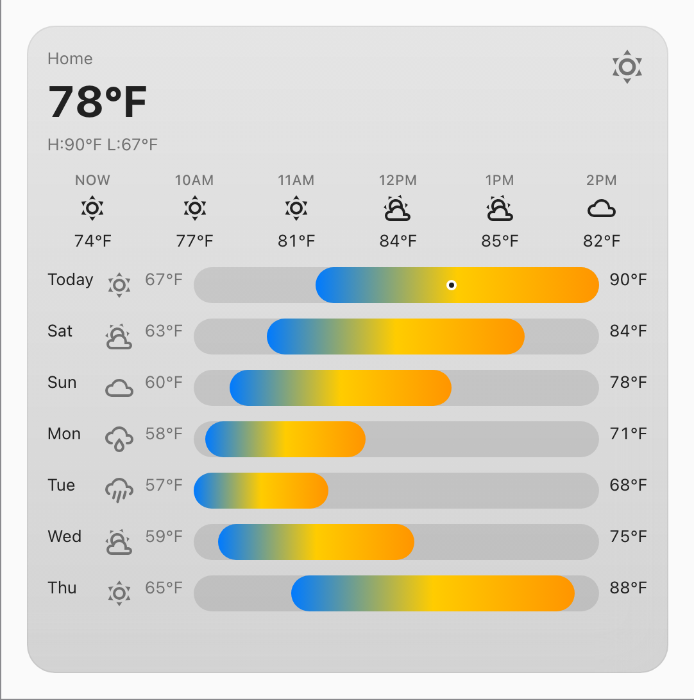
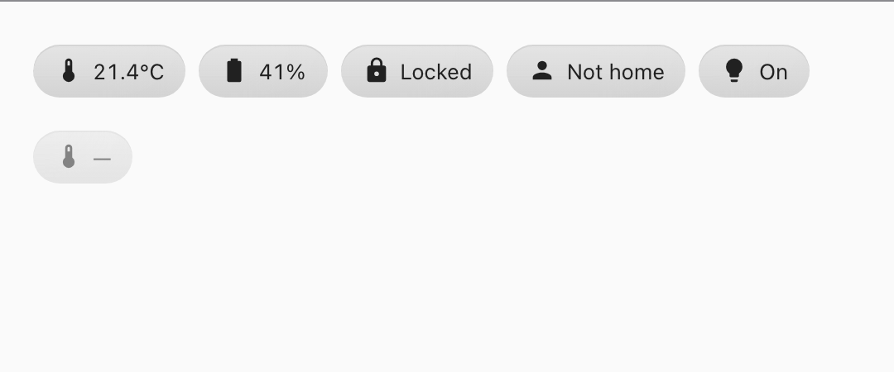
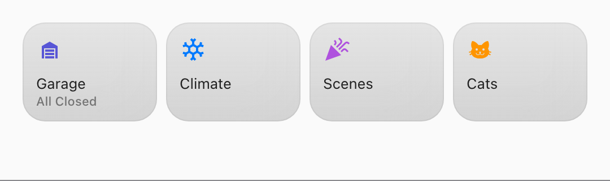
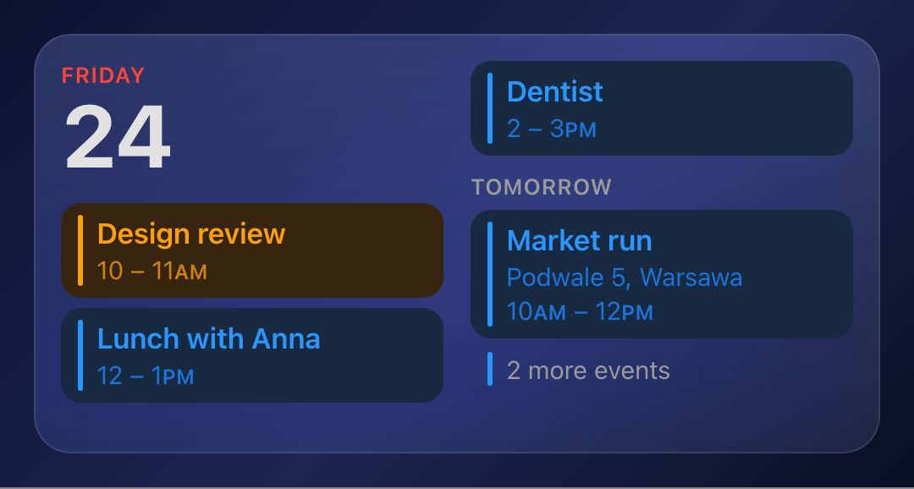

# Cupertino Plus

Widget cards for [Home Assistant](https://www.home-assistant.io/) dashboards, styled like the
ones on a phone's home screen: sensible defaults instead of a config to fill in, and a shape
taken from the box you drag them into rather than from a size setting.

**[Install](#install)** · **[The cards](#the-cards)** · **[Configuring](#configuring)** ·
**[Development](docs/development.md)**

[](https://github.com/64bitjoe/cupertino-plus/actions/workflows/ci.yml)
[](./LICENSE)
[](https://www.home-assistant.io/)

> **A fork.** This is a fork of
> [sabbaken/cupertino-widgets](https://github.com/sabbaken/cupertino-widgets) by
> **Kirill Verenih**, who wrote the calendar and battery cards and everything they stand on.
> The complication, weather, chips and tiles cards are the additions here. Same AGPL-3.0 licence, and
> the original copyright notice travels with every build.

It needs a current Home Assistant, **2026.7 or newer**: the cards track the latest frontend
APIs rather than carrying compatibility shims.

## Install

**HACS.** Add this repository as a custom repository of type **Dashboard**:

```
https://github.com/64bitjoe/cupertino-plus
```

Then install **Cupertino Plus** and reload your browser.

**Manually.** Download `cupertino-plus.js` from the
[latest release](https://github.com/64bitjoe/cupertino-plus/releases), drop it in
`config/www/`, and add it under **Settings → Dashboards → Resources** as a JavaScript module:

```
/local/cupertino-plus.js
```

## The cards

Eight of them, and a badge. Each one is in the card picker; none of them needs YAML.

### The calendar

Today's date, then today's events, then as much of the days after today as the card has room
for, one continuous flow poured through however many columns the footprint gives it. Each
event is tinted with the colour of the calendar it came from, and anything due out of your
to-do lists joins the same flow at its own time. Empty days simply do not appear.

<p align="center">
  
</p>

Every decision it makes is written down in
[`docs/calendar-widget-rules.md`](docs/calendar-widget-rules.md).

### The complications

Any entity, drawn the way a watch face draws one. Point it at one entity or several, pick a
style, and it works out the rest: the name, the icon, the unit, the colour, and whether there
is a range worth drawing an arc against.

<p align="center">
  
</p>

Nine faces: **circular** (a ring gauge), **gauge** (an open arc, like the Lock Screen's),
**bezel** (the name curved around the rim), **corner** (a curved gauge in each corner of the
card, like the Watch's Infograph face), **rectangular**, **rectangular with header**,
**rectangular full-bleed**, **rectangular graph** (name, reading, the high and low, and the
history filling the block — side by side when the card is small), and **inline** (a single strip
that stacks into a list).

**Layout: Bento** gives each entity a rounded cell of its own instead of one panel, packed like
the feature grids in Apple's keynotes: the first entity large, the rest small, unless a row picks
its own **Size** (small, wide, tall or large) and **Face**. The grid follows the card's footprint
— two columns at the small size, four at medium — and a cell that cannot fit shrinks before it
is left out, so nothing is ever drawn cut off.

Open any entity in the editor to give it its own name, icon, colour, range, and what a tap, a
hold and a double tap do; turn on **Use templates** and the name, icon, reading and a supporting
line can each be a template (a reading that answers a number moves the gauge too). **Show recent
history** draws a Stocks-style line of the last 1 to 48 hours beside each numeric reading.
**Count down to times** turns a timer, a timestamp sensor, a date/time helper or a calendar's
next event into the time left, with a ring that drains like the Watch's Timer complication.
Both have a per-entity **Recent history** and **Count down** choice too — same as the card, on,
or off — and an entity can keep its own history window.

Two things it does that are worth knowing before you use it. The ring is simply not drawn
when the entity has no honest range to measure — a room's temperature has no ceiling, and an
arc against an invented one would be a fraction of nothing — so that face shows the icon and
the reading instead. And the colour comes from _what the entity measures_ and then holds
still; it never moves with the value, because a colour that stepped with the number would
just be a second, blurrier opinion about a number the gauge has already given you.

The rules, including the contrast work behind the coloured faces, are in
[`docs/complication-widget-rules.md`](docs/complication-widget-rules.md).

### The batteries

A ring per device, green all the way, with the level read off the length of the arc and a
bolt on whatever is charging. Point it at the battery sensors you care about and it works out
how many rings across, whether there is room for the percentages, and how big to draw them.

<p align="center">
  
</p>

The rules are in [`docs/battery-widget-rules.md`](docs/battery-widget-rules.md).

### The weather

One entity, and everything else follows from it. Current conditions first, then the next six
hours starting from right now rather than from whatever hour the forecast happens to begin at,
and — give the card enough room — the week beyond them, each day drawn as a low, a range bar
and a high. The bars all share one scale, the width of the whole week rather than of the one
day under it, so a warm day sits visibly to the right of a cold one instead of every bar
running the full width of its own row and telling you nothing next to its neighbours.

<p align="center">
  
</p>

The high and low printed under the current temperature come from the forecast, never from the
entity's own attributes — there is no such attribute to read — so even the smallest card, which
draws neither the hourly strip nor the daily list, still holds a subscription open for it. Night
is mostly a guess the card makes for itself: Home Assistant marks only one condition,
`clear-night`, as explicitly after dark, so every other glyph's day-or-night choice comes from
`sun.sun`'s actual position for the current hour and a plain clock for every hour after it,
because a sun's position is a snapshot and a forecast is not.

The rules, including why the bars are never scaled against themselves, are in
[`docs/weather-widget-rules.md`](docs/weather-widget-rules.md).

### The chips

A row of small pills, one per entity, each of them a press away from doing something. This is
the Lock Screen family rather than the Home Screen one: no card behind it by default, no colour
of its own, just one ink and a translucent scrim floating on your dashboard. A chip shows a
glyph and its entity's reading, or the glyph alone, or a small caption stacked over the
reading — and whichever of those you pick, every chip in the card draws at the same height, so
the row reads as one band rather than as a ragged line.

<p align="center">
  
</p>

A press opens more-info by default, and per chip it can toggle, navigate to another view, go
back, open a web page, call a service (`call-service` or Home Assistant's newer `perform-action`),
open Assist, or be turned off entirely; a hold and a double tap can each do any of those too,
set from the same panel,
any action can ask for Home Assistant's confirmation dialog, and a template can reach any string
in it, a service's `data` and `target` included — a chip that does nothing is drawn as a chip that does
nothing, with no button role and no tab stop. The row wraps onto a second line rather than
hiding a chip, and the card asks Home Assistant for exactly the height that takes: it arrives
with the Layout tab's **Auto height** on, so it sits at the height of its chips with no strip of
empty dashboard under it, and nothing to set in `grid_options`. Put it over a busy
wallpaper and the translucency has nothing predictable behind it; `container: card` is the
answer, and gives the pills an ordinary card surface to sit on. `alignment: center` (or `end`,
or `justify`) moves a row's chips along it.

The rules, including the two containers and what a press can be made to do, are in
[`docs/chips-widget-rules.md`](docs/chips-widget-rules.md).

### The tiles

A wrapping grid of small rounded tiles, one per shortcut, each a glyph, a name and a line of
state. This is the Home Screen family where the chips are the Lock Screen one: a tile is a
coloured object rather than a mark in one ink, so it tints itself from what its entity is (a
thermometer orange, a lock red, a scene purple) and a `color` of your own overrides that. At
rest the colour is in the glyph, and the tile fills with it on hover or press; `wash: always`
keeps every tile filled. Tiles share their row's width equally, so a row fills its section edge
to edge, and wrap only when a tile would fall below 96 units: four across a section of about
410px or more, three on a phone. There is no column count to keep in step with a box you can
drag. To keep each row on one line however narrow the card, set `flow: row` (**Rows: One line
per row** in the editor): the tiles narrow to share the line instead, their names ellipsizing,
and a `break` still starts a new row. Like the chips, the card is exactly as tall as its tiles
(Auto height in the Layout tab) unless you drag it to a row count of your own, in which case the
tiles sit at the top of the taller box.

<p align="center">
  
</p>

A tile does not need an entity: with a name, an icon and a `navigate` press it is a shortcut
to another view, and leaves its state line empty (a dash there is kept for an entity that is
not reporting). Name, icon, colour, state and
visibility can each be a template. A press opens more-info by default on a tile with an
entity (one without defaults to no action), and takes every action and gesture a chip does.

A tile with an `area` (**Room** in the editor) is a room tile, the line under a room in the Home
app: its name and icon come from the area, and its state line says what the room is doing,
"Door Open · Occupied · 72° · 2 Lights On", with each fact shown only while it has something to
say. Tick which facts it shows; the temperature comes from a sensor you choose, on the tile or in
the area's own settings, never a guess. `summary_style: icons` (**Show them as: Icons**) keeps
only the temperature, humidity and Reading as words, and draws the rest as a row of small tinted
status icons under them, as the Home app's tiles do: a bulb and a 3, an open door, a red leak
first. What does not fit a narrow tile folds into a "+2" rather than being cut off, and a screen
reader hears every icon's meaning in the tile's label.

Every room (a room tile, a room row of chips, the room card) can be customised from its panel:
drag the facts under **Show** into your own order (alerts always stay first), **Leave out**
things in the room that should never count (`exclude`, the garage door that is always open),
**Also count** things from other rooms (`include`, the hall lock for the entrance), and add
**Your own icons** (`extras`): an entity, an icon and a colour, shown in a state you pick or
while a template is true, with words for VoiceOver and a few characters beside the icon if you
like.

For a column of status rows rather than a grid of shortcuts, `orientation: horizontal` puts the
glyph beside the name and draws each tile one grid row tall, and `state_lines: 2` (or 3) lets a
long status wrap instead of ellipsizing. `selected`, usually a template, fills one tile with its
colour at rest, the way a segmented control marks the current choice: a row of oven presets
that shows which one is set.

The rules, including why tiles carry a colour where chips refuse one, are in
[`docs/tiles-widget-rules.md`](docs/tiles-widget-rules.md).

### The room

The top of a room in the Home app: the room's name, and under it a pill for each thing the room
has to say, in the Home app's order and colours. Something needing attention first, in red
(a leak, smoke, a jammed lock), then what is open or unlocked, who is there, the temperature,
the lights, and what is playing. Pick the room and it does the rest; pressing a pill opens what
it is about, and pressing the name can take you to the room's own view. A quiet room shows only
its name.

```yaml
type: custom:cupertino-plus-room
area: kitchen
tap_action: { action: navigate, navigation_path: /home-os/kitchen }
```

The temperature comes from a sensor you choose, on the card or in the area's own settings in
Home Assistant; it is never guessed from the room's sensors, which in a real kitchen include the
freezer. The same pills can sit in a chips card too: a chip with an `area` and no entity is a
room row.

### The live activities

Apple's Live Activities, for the appliances and jobs that run a while: a glass panel per running
job with what it is doing ("Rinsing", "Printing · Layer 120 of 300"), a progress bar, and the time
left, set large like the Lock Screen's, or one slim pill each like the Dynamic Island. When a job
ends it says Done, in green, for ten minutes (a failed print says so in red), and then goes away;
when nothing is running the card hides itself, or says "Nothing running", or shows everything
dimmed: your choice.

```yaml
type: custom:cupertino-plus-live-activity
activities:
  - entity: sensor.front_load_washer_current_status
    remaining_entity: sensor.front_load_washer_remaining_time_2
    total_entity: sensor.front_load_washer_total_time
  - entity: sensor.p1s_01p00c5b1502493_print_status
    phase_entity: sensor.p1s_01p00c5b1502493_current_stage
    progress_entity: sensor.p1s_01p00c5b1502493_print_progress
    remaining_entity: sensor.p1s_01p00c5b1502493_remaining_time
    step_entity: sensor.p1s_01p00c5b1502493_current_layer
    step_total_entity: sensor.p1s_01p00c5b1502493_total_layer_count
    step_label: Layer
```

The time left can be minutes, hours, `1:05:00`, or the time it finishes (LG ThinQ reports that);
progress comes from a percentage sensor, or from the time left against the whole job. Off, idle,
standby and power off already count as idle; a device with its own codes (a Litter-Robot) can
name the states that mean running instead, all from the editor. In the last hour the countdown
turns to `23:05` and ticks each second, like the Timer, but only while the card is on screen
(`seconds: never` or `ten_minutes` to change that). A job that finished before you opened the
dashboard still says Done, checked against the recorder, so a Home Assistant restart never
claims every appliance has just finished. The name, icon, phase line, supporting text, time
left and whether an activity shows at all can each be a template.

### The badge

One chip, as a Home Assistant badge: the same glass pill at the 36px height the frontend gives
its own badges, so it sits in a row of theirs. It takes a chip's keys (`entity`, `name`, `icon`,
`color`, `value`, `show`, `content`, and every action) and any of them can be a template, so a
"Lights on" count is one `value`. Add it from the badge picker, or as
`type: custom:cupertino-plus-badge`. A `show` that answers false hides it, gap and all.

## Coming from Mushroom

The tiles, chips and badge cover what the Mushroom template card, chips card and template badge
are used for, and read most of the same YAML:

| Mushroom                                   | Cupertino Plus                                    |
| ------------------------------------------ | ------------------------------------------------- |
| `template-card` `primary`                  | a tile's `name`                                   |
| `secondary`, `multiline_secondary`         | a tile's `value`, and the card's `state_lines: 2` |
| `layout: horizontal`                       | `orientation: horizontal`                         |
| `icon_color: amber` (and every other name) | `color: amber`, mapped onto the palette           |
| chips `alignment: center`                  | chips `alignment: center`                         |
| back chip                                  | a chip with `tap_action: { action: back }`        |
| `template-badge`                           | `custom:cupertino-plus-badge`                     |
| `perform-action`, `hold_action`, …         | the same keys, unchanged                          |
| `{{ entity }}`, `{{ user }}` in a template | the same variables, beside `config.entity`        |

## Configuring

Every card has a visual editor — add it from the picker and fill in the form. Nobody needs to
write YAML, and there is no size field in any of them: **Home Assistant's Layout tab owns the
footprint**, and the card re-lays itself out for whatever box you drag it into. The chips and
tiles cards are the exception that proves it: they default to Auto height, so their footprint is
their content until you drag one.

The nine types, if you do want to paste config:

| Card          | Type                                  | Asks for                                      |
| ------------- | ------------------------------------- | --------------------------------------------- |
| Calendar      | `custom:cupertino-plus-calendar`      | nothing — it finds your calendars             |
| Complication  | `custom:cupertino-plus-complication`  | entities, and a style                         |
| Battery       | `custom:cupertino-plus-battery`       | which battery sensors                         |
| Weather       | `custom:cupertino-plus-weather`       | one weather entity                            |
| Chips         | `custom:cupertino-plus-chips`         | entities, and what a press on each one does   |
| Tiles         | `custom:cupertino-plus-tiles`         | which shortcuts, and what each one opens      |
| Room          | `custom:cupertino-plus-room`          | which room                                    |
| Live Activity | `custom:cupertino-plus-live-activity` | which appliances, and their time-left sensors |
| Badge         | `custom:cupertino-plus-badge`         | an entity or a template, as a view badge      |

Every card also takes `scale`, a percentage of the size it was designed at, for dashboards
being read from across a room.

And every card takes `container` (**Background** in the editor), and every card defaults to
`glass`, so a dashboard of them reads as one material out of the box. The chips and tiles float
on the dashboard; the calendar, battery, complication and weather cards draw the same
translucent glass as a tile, as a panel with its inset intact. Set `container: card` on any of
them for your theme's own card instead, which is what the four panel cards drew by default up
to v1.16.

<p align="center">
  
</p>

### Glass on every card

The glass is three theme variables, so a Home Assistant theme can hand the same material to
every other card on the dashboard as well. Our cards read `cupertino-glass-fill`,
`cupertino-glass-ring` and `cupertino-glass-filter` before their own defaults; Home Assistant's
own `ha-card` reads `ha-card-background`, `ha-card-border-color` and the rest, including
`ha-card-backdrop-filter`, so no card-mod is needed for the blur. Point the second set at the
first and there is one definition of the glass, in your theme. The values below are exactly
the library's defaults, light and dark, so our cards look the same with or without it:

```yaml
# themes/cupertino-glass.yaml, with `frontend: themes: !include_dir_merge_named themes`
Cupertino Glass:
  modes:
    light:
      cupertino-glass-fill: 'linear-gradient(to bottom, color-mix(in srgb, var(--primary-text-color) 10%, transparent), color-mix(in srgb, var(--primary-text-color) 18%, transparent))'
      cupertino-glass-ring: 'color-mix(in srgb, var(--primary-text-color) 6%, transparent)'
    dark:
      cupertino-glass-fill: 'linear-gradient(to bottom, color-mix(in srgb, var(--primary-text-color) 16%, transparent), color-mix(in srgb, var(--primary-text-color) 9%, transparent))'
      cupertino-glass-ring: 'color-mix(in srgb, var(--primary-text-color) 12%, transparent)'
  cupertino-glass-filter: 'blur(24px) saturate(180%)'
  # Every other card:
  ha-card-background: 'var(--cupertino-glass-fill)'
  ha-card-border-color: 'var(--cupertino-glass-ring)'
  ha-card-border-width: '1px'
  ha-card-box-shadow: 'none'
  ha-card-backdrop-filter: 'var(--cupertino-glass-filter)'
```

Change a `cupertino-glass-*` value and our cards and everyone else's change together. The
glass only reads as glass over something worth blurring, so pair it with a wallpaper
(`lovelace-background`, or the dashboard's own background setting). One side effect to know
about: `ha-card-background` is also the colour a few of our details cut out of the card behind
them (the ring around the weather card's today dot, and the battery card's charging notch
under `container: card`), and a gradient is not a colour, so with this theme those lose their
cut-out. And `container: card` draws Home Assistant's own card, which under
this theme is the same glass.

If you would rather use card-mod, `card-mod-card` can set `backdrop-filter` on `ha-card` in
place of `ha-card-backdrop-filter`. Leave our chips and tiles out of it with
`ha-card:not(.glass)`: they draw the glass on each chip and tile, and a blurred card around them
would leave nothing for theirs to blur (they refuse the theme's blur for the same reason).

## Development

`pnpm install && pnpm dev` serves the showcase — every card against a mock Home Assistant,
with no install needed. See [`docs/development.md`](docs/development.md) for the full loop,
and [`docs/ha-api-notes.md`](docs/ha-api-notes.md) for what has actually been verified
against the frontend rather than assumed.

## Licence

[AGPL-3.0-only](./LICENSE). Copyright © 2026 Kirill Verenih, with modifications © 2026
Joe Speakman. If you run a modified version where other people can reach it, the licence
asks you to offer them the source.
