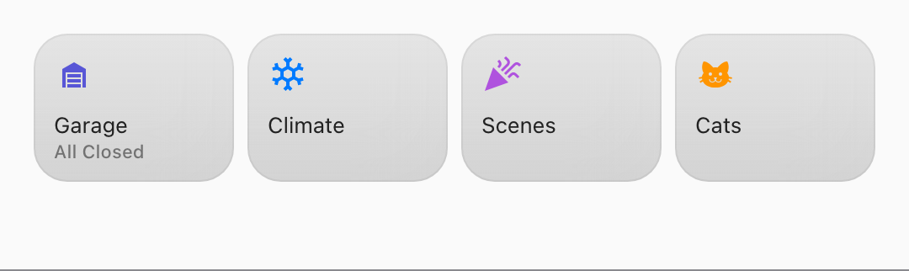
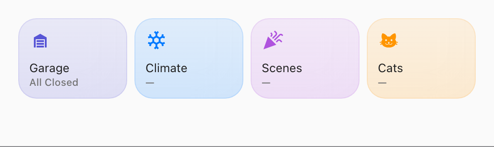

# Tiles widget: the rules

One card, a grid, and the premise the chips card refuses: a tile is not a mark on somebody
else's wallpaper, it is an object on a Home Screen. Point it at some entities and it draws one
small rounded tile each: a glyph, a name, a line of state, and a press that goes somewhere.
This is the specification the card implements; the code follows it module by module, and
`src/cards/tiles/*.test.ts` pins the worked cases below.

Read [`chips-widget-rules.md`](chips-widget-rules.md) first. This card is its sibling and
adopts most of it: the row reading, the templates, the press, the two containers and the
wrapping arithmetic are the chips card's, imported rather than copied. Where this document says
"unlike a chip", that is the sentence being paid for. The design it was built from is
[`docs/superpowers/specs/2026-09-07-tiles-card-design.md`](superpowers/specs/2026-09-07-tiles-card-design.md);
where the two disagree, this document describes what shipped.

<p align="center">
  
</p>

---

## 1. What a tile is

```ts
{
  entityId: string | undefined, // identity, and what a press acts on; undefined for §4
  name: string,         // drawn, unlike a chip's name in two of its three modes
  icon: string,         // an `mdi:` name; `mdi:apps` when nothing says otherwise
  picture: string | undefined, // an entity_picture, drawn in the glyph's place
  value: string,        // the state line; an em dash for not reporting, '' for §4 with none
  color: string | undefined,   // a resolved CSS value: the glyph, and a wash (§3a)
  unavailable: boolean,
  visible: boolean,     // whether the tile is drawn at all
  break: boolean,       // this tile starts a new row
  action: ActionConfig  // what a press does; see §6
}
```

`model.ts` is the whole of the card's contact with Home Assistant, the same split every other
card in the library makes: everything downstream draws a `TileView` and knows nothing about
entities. What a row _is_ (an entity or none, a bare string or an object, templates in the same
five fields) is the chips card's question and `model.ts` asks it by importing the chips model's
own functions. What differs is what a tile draws. It always draws icon, name and state, so
there is no `content`; it already shares its row's width (§2), so there is no `fill`; and an entity-less tile is a
navigation tile rather than a spacer.

A tile is a Home Screen object, and that one sentence decides most of what follows. A chip is
one ink on a wallpaper; a tile is a coloured thing with a name on it, sitting among its peers.

## 2. The grid, and why it wraps

**Tiles share their row and wrap.** The tiles in a row divide its width equally, so a row fills
its section edge to edge as Apple Home's does, and a line wraps only when one more tile would
push every tile below its minimum width: four across a section of about 410px or more, three on
a phone, reflowing rather than cramping. There is no `columns:` setting.

That is not the obvious choice, since Home Assistant's own grid card takes a column count, so it
is worth saying why. A `columns: 4` card dragged narrow gives four cramped tiles; a wrapping
one gives two rows of two. The card already knows how wide it is, and a number the user has to
keep in sync with a width they can drag is a number that will be wrong. It is also the
arrangement the chips card reached after four releases of getting the arithmetic wrong, and
reusing that code is worth more than matching a convention.

The arithmetic is `core/wrapping.ts`, shared with chips and generic over "a thing with a
width". Every tile is priced at its minimum width, which is the degenerate case of the chips card's
content-priced one rather than a second function: a stretched tile is wider only because the
line had room to spare, so the line count at the minimum is the line count the grid draws. Every detail in that module was earned by a
bug (the width comes from the measurement, a container's inset is told rather than assumed),
and writing them out again from memory is how they come back. `break: true` works exactly as
chips' §2a describes, with the same three rules: it says where a row starts rather than that it
fits, it is ignored on the first tile, and it is not templatable.

**A tile is at least 96 units wide, and 88 tall.** The spec guessed a fixed 112 by 96 and asked
the first render to settle it. The render settled the height; the first live dashboard settled
the width.

- **The width** was a fixed 112 in v1.13.0, and in the user's glass column of about 425 three
  fitted and the fourth wrapped alone beside a third of a column of nothing. It is now a
  minimum, pinned from both sides. Four across must fit that column with room to spare
  (4 × 96 + 3 × 8 = 408), and four across must fit a 500px section in card mode inside its two
  16-unit insets (468), which 112 never did. Below it a name stops reading: the name gets the
  tile less its two 12-unit paddings, 72 at the minimum, which holds "Hall Lamp" and "Front
  Door" at footnote size and ellipsizes "Living Room", with the whole name in the tooltip. That
  is only at the wrap point itself; at 425 a tile is 100 and "Living Room" reads whole.
- **Every row shares one set of columns.** Each row is a CSS grid of equal tracks no narrower
  than the minimum, capped at as many columns as the card's longest row has tiles. The cap is
  what fills the line: four tiles in a 640 column are four tiles of 154, not four of six
  narrower columns with a hole beside them. The tracks are what keep the grid a grid: a forced
  row of one under a row of four, or the last line of a wrapped row, takes one column of the
  rows above it rather than stretching across the card. A card of two tiles in a wide column
  does make two wide tiles; that is the row being shared, which is what was asked for.
- **The height** comes from the sections grid rather than from taste. A grid row is 56 with an
  8 gap, so two lines of 88-tall tiles are 184, which is exactly three rows, and one line inside
  the card container's two 16-unit insets is 120, which is exactly two. At 96 both spilled into
  one more row: a glass card of two lines asked for four rows and left 48px of dashboard empty
  under it. And 88 is not cramped: the glyph still clears the name by nine pixels, and the
  glyph-top, text-bottom split reads as two groups.

The floor is two tiles across rather than the chips card's three, because a tile is about twice
a chip's width and a floor of three would make the narrowest reachable card wider than many
sections: five grid columns on glass, six in card mode. Like the chips card's it is priced from the measured width once there is one,
and the card asks Home Assistant for exactly its own content height.

**Exactly, not to the nearest row.** Up to v1.15.0 that request was `rows: min_rows`, and a row
count is a quantised height: one line of glass tiles is 88, the two rows that cover it are 120,
and a live dashboard showed the 32px strip of empty section under the card. Setting
`grid_options: { rows: auto }` was worse, 248px around 88px of tiles, because every card in the
library carried the 248 default footprint as a `min-height` and under auto nothing imposed a
height for the floor to clamp to. So the card now answers `rows: 'auto'` from its own
`getGridOptions()` (Home Assistant's heading card does the same; `core/floors.ts` cites the
frontend source) and carries no footprint floor (`sizing` in `core/base-card.ts`): it is the
height of its tiles in the sections layout, in masonry and in a panel, with nothing in the
user's YAML. The Layout tab shows Auto height on; turning it off lands on `min_rows`, the fewest
rows that hold the tiles, and a row count dragged taller than that draws the tiles at the top
of the box with the rest empty, never clipped. That is also why the 88 above still matters: it
is what keeps that fallback exact for one and two lines.

### 2b. One line per row: `flow: wrap | row`

Asked for by the second live dashboard, whose glass column was 396: four 96s and three gaps are
408, so Cats wrapped onto a line of its own. `flow: row` keeps each configured row on one line
however narrow the card; `wrap`, the default, is the grid above unchanged. A `break` still
starts a new row under both, so `row` is one line per row, not one line in all.

- **The name.** `flow`, because Home Assistant's own card editor already has a Layout tab, and
  a `layout` key meaning something else would be read as that one. Two named values rather
  than `wrap: false`, as `wash` and `container` are, so a third (a row that scrolls) would be a
  value. Unknown values draw `wrap`, silently, as theirs do.
- **The columns.** Exactly as many as the card's longest row, `minmax(0, 1fr)` each, so nothing
  can wrap. The longest row's count rather than each row's own: rendered with rows of four and
  two at 396, each row's own count drew the two twice as wide as the four above them, the
  ragged grid auto-fit was rejected for. The shared count keeps one grid, and means `row` draws
  exactly what `wrap` does wherever the longest row fits at 96: the option changes nothing until
  a line is too narrow to hold its row.
- **Narrow.** Names and states ellipsize; at the user's 396 a tile is 93 and every name reads.
  The width floor prices the longest row at 64 a tile (4 × 64 + 3 × 8 = 280, seven grid columns
  of a typical section, eight in card mode), where a name is four letters and an ellipsis. Below
  that nothing stops the tiles narrowing, because the one promise is never to overflow the card:
  under 48 the glyph no longer fits its paddings and the tile clips it at its own edge. The
  height is one line per configured row whatever the width.

## 3. Colour: a tile has an identity

**A tile tints itself from what its entity is, and a per-tile `color` overrides that.**

This is the chips card's §3 turned over, and on purpose. That rule says a chip opts out of
identity because a Lock Screen accessory is a mark in one ink, and the argument is good and is
about the Lock Screen. A Home Screen tile is the opposite object: the thing that _carries_ an
identity. It is why the four hand-coloured cards this one replaces were each their own colour,
and why nobody configured them that way one at a time.

The order is: the tile's own `color`, then the card's `color`, then `tintFor` in
`core/tint.ts`: temperature orange, lock red, light yellow, the rest by device class and domain,
as the complication card has always done. Chips never call it, and that is what keeps them
monochrome. The colour always paints the glyph, and paints a wash behind it when §3a says so,
in the chips card's three cases: light glass, dark glass, and card mode mixed into the opaque
track. The name and the state line stay one ink, for the reason the complication card gives
about colour that moves with a value.

A `color` is a palette name (`red`, `orange`, `yellow`, `green`, `teal`, `blue`, `indigo`,
`purple`, `pink`, `grey`, `accent`), any CSS colour, or a template answering either. `grey` is
Apple's systemGray, the one neutral, for a state that is off. The Material names other cards use
are read too and land on the nearest palette token (`core/tint.ts`'s `ALIASES`): `amber` is our
yellow, `deep-orange` orange, `cyan` teal, `blue-grey` and `disabled` grey, and `white` and
`black` are the label ink, so a tile tinted `white` on a dark dashboard does not vanish on a light
one. Names are read case-insensitively.

Two things differ from a tinted chip, both found in the first render rather than argued in
advance:

- **The wash is lighter, about two thirds of a chip's weights.** The chip's alpha was tuned
  for a small pill; over a tile's six-times-larger area it made a grid of eight a wall of pastel
  in light and of brown and olive slabs in dark, with the ground competing with the glyph for
  the colour. Two thirds keeps every tile identifiable at a glance and leaves the glyph to
  carry the hue.
- **A `scene` tints purple, on tiles only.** `tintFor` answers `accent` for a scene, which under
  Home Assistant's default theme is a light blue, and the first render put a scene tile beside
  a person and a climate shortcut as a third blue tile. A scene is also the commonest thing in
  a shortcut grid, and the Scenes card this replaces was purple. The override is a small table
  in the tiles model; `core/tint.ts`'s shared one is unchanged, so the complication card still
  draws a scene as it did.

### 3a. When the wash shows: `wash: hover | always`

**By default a tile washes only while it is hovered, pressed or keyboard-focused** (`wash:
hover`). At rest it is the plain glass or surface tile, and only its glyph carries the colour.
`wash: always` is v1.13.0's tile, washed at rest, exactly as it was.

<p align="center">
  
</p>

The default is the first live dashboard's choice. What it buys is a resting grid that reads as
one family of plain tiles, told apart by their glyphs, with the colour arriving as the answer to
a pointer or a finger, where it says "this is a button".

- **Hover only where the device can hover** (`@media (hover: hover)`). On a touch screen a tap
  leaves `:hover` stuck on the last tile touched, which would leave one tile washed for no
  reason until the next tap.
- **A tile whose press is `none` does not wash on hover or press.** It is not a button, and
  answering a pointer as if it were is the lie §6 refuses. Focus cannot reach it either, since
  it has no tab stop.
- **The wash fades** over the library's short duration, and not at all under
  `prefers-reduced-motion`. A gradient cannot be animated, so the plain tile and the wash are
  two layers under the content that crossfade their opacity.
- **An unavailable tile never washes**, because it never has a colour (below).
- **A value other than `hover` or `always` reads as `hover`**, silently, as an unknown
  `container` does.

**An unavailable tile drops its colour**, like every other card here. The dimming is the signal,
and a crisp tint undercuts it.

## 4. Templates, and a tile with no entity

Both are the chips card's, adopted rather than re-argued (see
[`chips-widget-rules.md`](chips-widget-rules.md)). `name`, `icon`, `color`, `value` and `show`
may each be a template, a string holding `{{` or `{%`, resolved through the shared
subscription pool. `{{ config.entity }}` is in scope, so one template serves every tile.
The card-level `color` and a tap action's `navigation_path` and `service` take templates
too. `entity` is never templatable: it is the row's identity, and the card needs it before anything
resolves.

`entity` is **optional.** A tile with none and a `name` and `icon` of its own is a navigation
tile, which is what Climate, Scenes and Cats actually were in the config being replaced.
Unlike a chip, an entity-less tile is not a spacer, because a tile is a labelled object and one
with a name and an icon has plenty to draw. There is no spacer concept at all; a grid of
tiles that already share their row has no use for one. Its default press is `none`, for the
chips card's reason: there is nothing to open.

## 5. The state line, and when it is a dash

`value` is the entity's formatted state through `core/entity-view.ts`, so a tile, a chip and a
complication never disagree about what a thermostat reads, unless a `value` template replaces
it.

**The dash means "not reporting", and nothing else.** A missing or `unavailable` entity draws
an em dash, beside the 55% dim, and that pair is the one signal the card has for a tile whose
reading cannot be trusted.

**A navigation tile with no `value` draws an empty line.** Up to v1.15.0 it drew the dash too,
copying the cards being replaced (`Climate –`, `Scenes –`), on the grounds that a blank line
would make the grid ragged. On a live dashboard it read the other way: a column of Climate,
Scenes and Cats shortcuts under a Garage reading `All Closed` looked like three broken tiles,
because the dash already meant "not reporting" two lines up this section. So an entity-less
tile whose `value` is absent or resolves empty now reads `''`, and the element draws a
no-break space in its place: the line keeps its height, so every name in a row still sits on
one baseline and the grid stays exactly as regular as the dash kept it, without the ink. Its
accessible name is the tile's name alone, with no dash and no stray comma.

An entity tile whose `value` template is empty, or not yet answered, still falls back to the
entity's formatted state; only a tile with no entity can have nothing to say.

## 6. The press, and the container

Both are the chips card's. `container: glass | card` means what it means there, including that
glass is the default and insets by nothing in either direction. That was the fix that ended the chips sizing saga
and is the thing most likely to be re-broken by writing a second card's padding from scratch.
One departure: a glass tiles card does not clip. Every card's `ha-card` has `overflow: hidden`
at the card's outer radius (22, or the theme's, 24 on a stock 2026 frontend), and with no inset
the tiles in the card's corners met that clip. v1.14.0 drew those three corners at the card's
wider curve with their ring cut away, and cut the focus ring along every outer edge. The card
container keeps its clip; its inset keeps the tiles clear of it.
The press is `core/actions.ts`, and §7 of the chips rules is the whole of it: the eight
actions (`back`, `url`, `assist` and `perform-action` among them), templates anywhere in an
action's `data` and `target`, `confirmation`, and `hold_action` and `double_tap_action`. The same
rule holds that a tile with nothing to do on any gesture is not drawn as a button: no role, no tab
stop, no pressed state.

## 6a. The shape of a tile: `orientation` and `state_lines`

`orientation: vertical` is every tile up to v1.17: glyph over name over state. `horizontal` puts
the glyph beside a name-over-state block, centred on the tile's height: Apple Home's small tile,
and Mushroom's horizontal template card. It is its own pair of numbers rather than the vertical
tile on its side (`tileMetrics` in `layout.ts`):

| Orientation  | Minimum width | Height at one state line | Under `flow: row` |
| ------------ | ------------- | ------------------------ | ----------------- |
| `vertical`   | 96            | 88                       | 64                |
| `horizontal` | 148           | 56                       | 96                |

56 is one sections row exactly: two 12 paddings and a name over one state line are 55, and one
unit of air buys a tile that a grid row holds with nothing left over, so a column of horizontal
tiles is a list of status rows with no strip of dashboard under it. 148 leaves the name 90 beside
the glyph, more than a vertical tile's 72; two fit across a phone and the user's 425 glass column,
three across a 500 card-mode section.

`state_lines: 1 | 2 | 3` lets the state wrap before it ellipsizes, and adds a caption line (13
units) to the tile's height for each line past the first. Card-wide rather than per tile, because
a tile's height is its row's: a row of tiles that disagreed about it would no longer be a row.
Every tile reserves all its lines whether its text needs them or not, so a one-line state beside a
two-line one keeps its name level with its neighbour's. A line break in the text (`\n` in a
template) is kept, so a template can say where its first line ends. The stylesheet is handed the
same numbers as the floor (`--cw-tile-min`, `--cw-tile-height`), so the two cannot disagree about
where a tile wraps.

## 6b. The chosen tile: `selected`

A tile's `selected`, usually a template read with `show`'s truthy rule, draws it washed in its
colour at rest whatever the card's `wash`, with a ring in its own colour and its name at the
heavier weight a chosen segment has. The ring is what makes it a selection under `wash: always`
too, where every tile is washed. It is announced (`aria-pressed`) as well as drawn, so the colour
is not the only thing carrying it. An unavailable tile is never selected: it has no colour to wash
with, and the dim is already saying the one thing worth saying about it.

```yaml
type: custom:cupertino-plus-tiles
flow: row
tiles:
  - name: 180°
    icon: mdi:thermometer
    color: orange
    selected: "{{ is_state('input_select.top_oven_temp', '180') }}"
    tap_action:
      action: perform-action
      perform_action: input_select.select_option
      target: { entity_id: input_select.top_oven_temp }
      data: { option: '180' }
  # …one tile per preset
```

## 6c. Room tiles: `area`

The status line under a room in the Home app. A tile with an `area` and no entity takes its
name and icon from the area and its state line from what is in the room, worked out by
`core/area-summary.ts`:

```yaml
- area: kitchen
  color: pink
  tap_action: { action: navigate, navigation_path: /home-os/kitchen }
```

| Part          | Says                              | From                                                    |
| ------------- | --------------------------------- | ------------------------------------------------------- |
| `alerts`      | Leak, Smoke, Gas, CO, Lock Jammed | moisture, smoke, gas, CO, safety, tamper sensors        |
| `open`        | Door Open, 2 Windows Open, 3 Open | door, window, garage, gate and opening contacts; covers |
| `locks`       | Unlocked, 2 Unlocked              | locks                                                   |
| `occupancy`   | Occupied, or Motion               | occupancy and presence, then motion                     |
| `climate`     | Heating to 70°, Cooling to 68°    | a thermostat that is running                            |
| `temperature` | 72°                               | one chosen sensor (below)                               |
| `humidity`    | 45%                               | one chosen sensor                                       |
| `lights`      | Light On, 3 Lights On             | lights, groups left out                                 |
| `media`       | Playing                           | media players                                           |

**What is in a room** is Home Assistant's rule: the entity's area, or its device's. Hidden
entities, config and diagnostic entities, and groups are left out: a group and its members are
one lamp counted twice.

**The parts and their order** are `summary`, a list; the default is the Home app's own line,
`alerts, open, locks, occupancy, temperature, lights`. A part with nothing to say is left out,
so a quiet room reads `72°` and an empty one reads nothing. The order is the list's own: the
panel's **Show** is Home Assistant's reorderable multi-select (chips with drag handles, an Add
button for the rest), since a checkbox list cannot say an order. **Alerts always come first**,
whatever the order: a leak must never be the last word, or the glyph folded into a "+2".

**The temperature is never guessed.** It comes from the tile's `temperature_entity`, else the
sensor chosen in the area's own settings in Home Assistant, else not at all. Tried against a
real house first: a kitchen holds the fridge and the freezer, a den a PC's chip temperature, a
mud room a litter robot, and neither a mean nor a median of those is a room. `humidity_entity`
is the same for humidity.

**A `value` is added after the summary**, so a template can say what no registry knows (who is
in the room, from a phone's area sensor) without rewriting the rest.

**Leave out** (`exclude`) is a list of entities in the room that never count: the garage door
that is always open, the motion sensor in the fish tank. The panel offers only the room's own.
**Also count** (`include`) is the opposite: entities from other rooms that count as this one's
(the hall lock for the entrance), sorted into parts by the same domain and device-class rules,
and counted once however often they are listed.

**Your own icons** (`extras`) are a list of small records, each edited in a dialog (Home
Assistant's object selector, with a drag handle for their order):

```yaml
- area: kitchen
  exclude: [light.kitchen_counter]
  include: [lock.hall_door]
  extras:
    - entity: sensor.bin_day
      state: today # one state, or several with commas
      icon: mdi:trash-can
      color: green
      name: Bins Out # the words, and what VoiceOver reads
    - entity: sensor.dryer
      show: "{{ is_state(entity, 'running') }}" # decides alone, over state
      text: "{{ state_attr(entity, 'minutes') }}m" # a few characters beside the glyph
```

| Key      | Default                                                                   |
| -------- | ------------------------------------------------------------------------- |
| `entity` | none; needed unless `show` is given                                       |
| `icon`   | the entity's own                                                          |
| `color`  | the entity's own tint; a palette name or any CSS colour                   |
| `state`  | shows while active: anything but off, closed, locked, idle, standby, away |
| `show`   | a template, read with `show`'s rule; `entity` is the icon's entity        |
| `name`   | the entity's name                                                         |
| `text`   | none; drawn where a count would go                                        |

They come after the built-in parts, in their own order: as glyphs under `summary_style: icons`,
as words on the state line otherwise (`name`, then `text`), and as pills in a chip row or on the
room card, where a press opens their entity. `icon`, `color`, `show`, `name` and `text` may be
templates. All three keys are shared by room tiles, room chip rows and the room card
(`core/area-form.ts` draws the same rows in each panel).

The tile repaints when anything in its room changes, when a device or an entity moves room
(or an entity is hidden or given a config or diagnostic category: any edit to the area, device
or entity registry), and when an entity it borrows or an icon of its own reads changes. The
registry walk behind that is done once per registry edit, not once per room per state push:
`core/area-summary.ts` keeps one map of every area's entities until a registry is replaced, and
the card keeps its watched list, and the tiles its last update read for `getGridOptions()`, the
same way (§7b of the chips rules has the detail).

### `summary_style`: words or icons

`words` (the default, and every room tile before the key) writes the whole summary on the state
line. `icons` splits it, `tiles/glyphs.ts`: the readings (`temperature`, `humidity`, then the
`value`) stay as words on the state line, and every status part becomes a glyph in a row under
it, the small tinted pills under a room in the Home app.

```yaml
- area: den
  summary_style: icons # the panel's "Show them as"
```

- **Which, and in what order.** Only parts with something to say, in the summary's order, so
  alerts come first. Each is tinted as the room chips are (`PART_TINTS`): alerts red, open and
  locks orange, occupancy blue, lights yellow, media indigo; a cooling thermostat blue.
- **Counts.** `alerts`, `open`, `locks`, `lights` and `media` carry their count beside the glyph
  once there is more than one (a bulb and a 3); one of a thing is the glyph alone. The figure is
  the label colour (an alert's stays red), tabular, so a 2 becoming a 3 moves nothing.
- **Overflow is decided, never clipped.** `fitGlyphs` prices every pill (18 tall; 18 wide alone,
  24 + 7 a figure with a count) against the width the tile is actually drawn at
  (`tileWidthFor` in `layout.ts`, the stylesheet's own grid rule over the measured card, the
  narrowest tile before a measurement), keeps glyphs from the front and folds the rest into a
  grey "+N". The row is a fixed height that wraps rather than shrinks, so a mispriced pill drops
  whole out of sight rather than half.
- **Height.** The row adds 22 to every tile in the card (`tileMetrics`' `glyphRow`), not only to
  the rooms, as `state_lines` does: a tile's height is the grid's. Tiles without glyphs keep an
  empty row so names still line up, and it is decided by the config (any room row set to
  `icons`), not by what a room has to say this minute, so a room going quiet never shrinks the
  grid. A vertical tile is 110; one glass line is still two sections rows. A horizontal tile
  draws the row under its text, 78 tall.
- **Not buttons.** The glyphs are inside a pressable tile, so they are not pressable themselves.
  The row is `aria-hidden`; the tile's label carries each glyph's words ("Den, 21°, Occupied, 2
  Lights On"), and a tile that is not a button carries them in a visually hidden line.
- **Readings are not rounded for you.** The temperature and humidity parts round to a whole
  number. A `value` template is printed as it renders, so a template reading `68.198 °F` should
  round itself (`| round(0)`), or use `temperature_entity` instead.

## 7. Degradation

- **Entity missing from `hass.states`**: the tile still draws, dimmed, from its configured
  identity, with the entity id for a name and a dash for state.
- **`unavailable` / `unknown`**: dimmed to 55% opacity, the state a dash, and no tint (§3).
- **An entity with a picture** (a person, a media player) draws it round in the glyph's place,
  unless an `icon` was typed on purpose or the tile is unavailable.
- **A `toggle` or `call-service` that fails**: a `console.warn` prefixed `[cupertino-plus]`
  and nothing else. A click handler never throws.
- **No tiles configured, or none visible**: `No Tiles`, centred, rather than an empty card.

## 8. Still open

- **The list editor is shared.** `tile-list-editor.ts` is a sortable list of
  `ha-expansion-panel`s with a drag handle, a duplicate and a delete button. It used to be the
  third hand-adapted copy of the battery and chips editors; it is now a subclass of
  `SortablePanelList` in `core/panel-list.ts`, which the chips, live-activity and complication
  lists share, and supplies only what a tile row is: its fields, its form translation, its
  header. The battery card's `device-list-editor.ts` is still its own older copy.
- **Tiles borrow chips' row-reading.** `tiles/model.ts` still reads its rows through
  `chips/model.ts` (`chipConfigs`, `chipTemplates`, `chipWatchedIds`), because a tile row is a
  chip row. The generic helpers it used to borrow from there now live in `core/`: row keys and
  write-back in `core/rows.ts`, the template request in `core/templates.ts`, the action form in
  `core/action-form.ts`, the colour dropdown in `core/color-form.ts`, and the default container
  in `core/container.ts`.
- **A `scene` tile's state line is its raw last-activated timestamp.** That formatting is
  `core/entity-view.ts`'s, which every card reads, so fixing it for tiles means fixing it
  for all of them.
- **Domains neither tint table knows fall back to `accent`**, the theme's primary: `switch`,
  `script`, `automation`, `button`. Under the default theme that is a light blue. A `color`
  on the tile or the card is the answer today.
- **No action key is YAML-only any more**, as on chips: a service call's Target and Data, the
  Entity override, Assist's options and Ask before doing it all have fields, on every gesture.
- **The spec's three flags are otherwise settled.** The size was settled by the render (§2),
  and `tintFor`'s tables by the render too: they suit tiles once a scene is overridden (§3).
  The third, the list editor, is the first item here.
- **Out of scope**: a `columns:` setting, spacers, and per-tile size.
